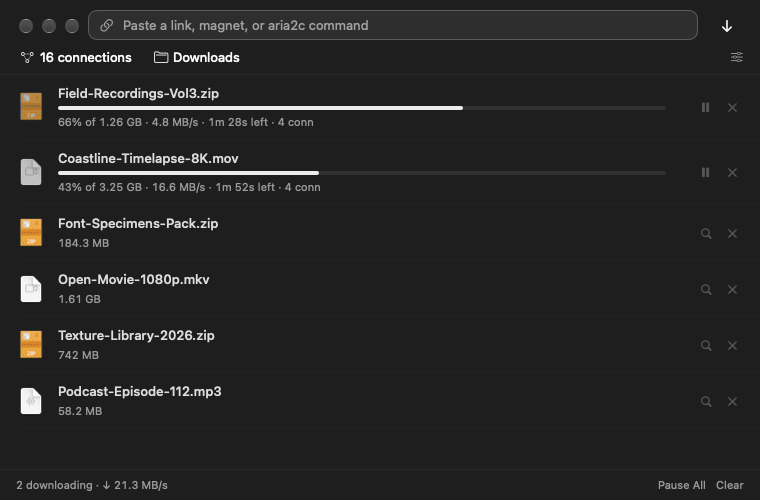
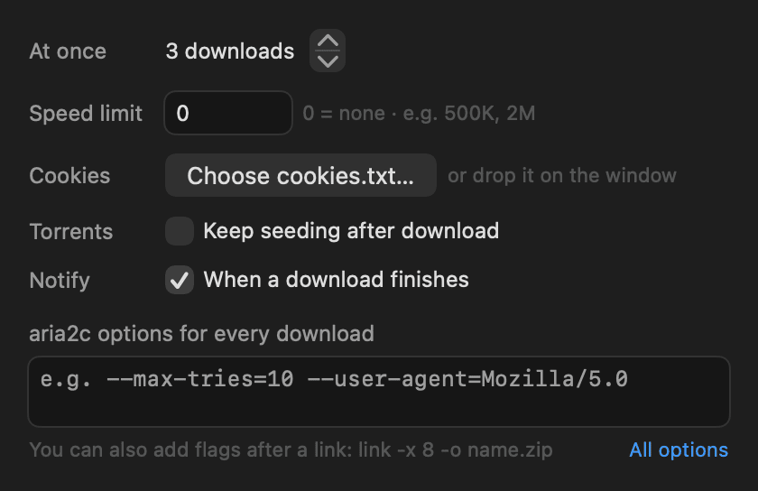

# Fetch

[aria2c](https://aria2.github.io) with a window. Paste a link — or a whole `aria2c` command line — pick connections and a folder, and download.





- Links, mirrors, magnets, `.torrent` and `.metalink` files (drop them on the window or open them with Fetch).
- Anything aria2c understands: `-x 8`, `-o name.zip`, `--header "…"`, `-Z`, `-i list.txt`, `--max-overall-download-limit=2M` …
- Connections per server, concurrent downloads, speed limit, seeding on/off, notifications.
- Load a `cookies.txt` (Netscape format) for sites that need you signed in. Fetch reloads aria2c when the file changes.
- Unfinished downloads resume the next time you open Fetch.

## Requirements

- macOS 26 or later.
- **aria2c**. Fetch is only a front end and doesn't include it. Install it with [Homebrew](https://brew.sh): `brew install aria2` (MacPorts' `aria2` works too). Fetch looks in `/opt/homebrew/bin`, `/usr/local/bin` and `/opt/local/bin`.

## Install

```sh
brew install aria2
git clone https://github.com/Byaydenrx/Fetch.git
cd Fetch
./install.sh
```

`install.sh` builds Fetch from source, copies it to `~/Applications` and opens it. To only build: `./build.sh` makes `build/Fetch.app` (universal: Apple silicon and Intel). Either needs Swift 6 from the Xcode Command Line Tools (`xcode-select --install`) or Xcode.

Downloaded builds aren't notarized, so macOS blocks them the first time: System Settings › Privacy & Security › **Open Anyway**. Building it yourself avoids that.

## How it works

Fetch starts aria2c as a JSON-RPC server bound to `127.0.0.1` on a random free port, with a random secret (passed in a config file only you can read, deleted once aria2c is up, so other accounts on the Mac can't see it in the process list), and `--stop-with-process` so it never outlives Fetch. Your own aria2 config file (`~/.aria2/aria2.conf`) is still read. Torrents use aria2's normal BitTorrent networking (DHT, peer connections); seeding is off unless you turn it on.

## Data

- `~/Library/Application Support/Fetch/session.aria2` — unfinished downloads (aria2's session file)
- `~/Library/Application Support/Fetch/history.json` — finished downloads
- Settings: Fetch's preferences. Log: `~/Library/Logs/Fetch.log` (trimmed to the newest 256 KB once it passes 1 MB)

## Test modes

`Fetch --parse "<links and flags>"` (how a paste is read), `--get "<links and flags>"` (downloads, prints progress, quits), `--shot out.png`, `--shot-settings out.png`. Set `FETCH_ROOT=<dir>` and `FETCH_FOLDER=<dir>` to keep tests out of your real session and Downloads.

## License

MIT — see [LICENSE](LICENSE). aria2 itself is GPL-2.0 and installed separately.
